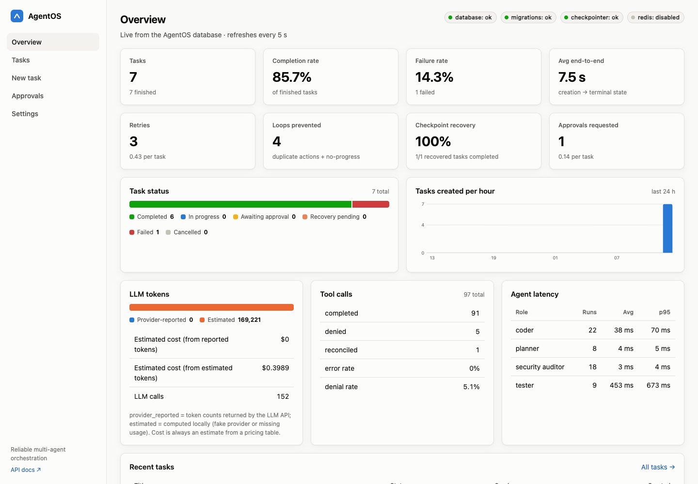
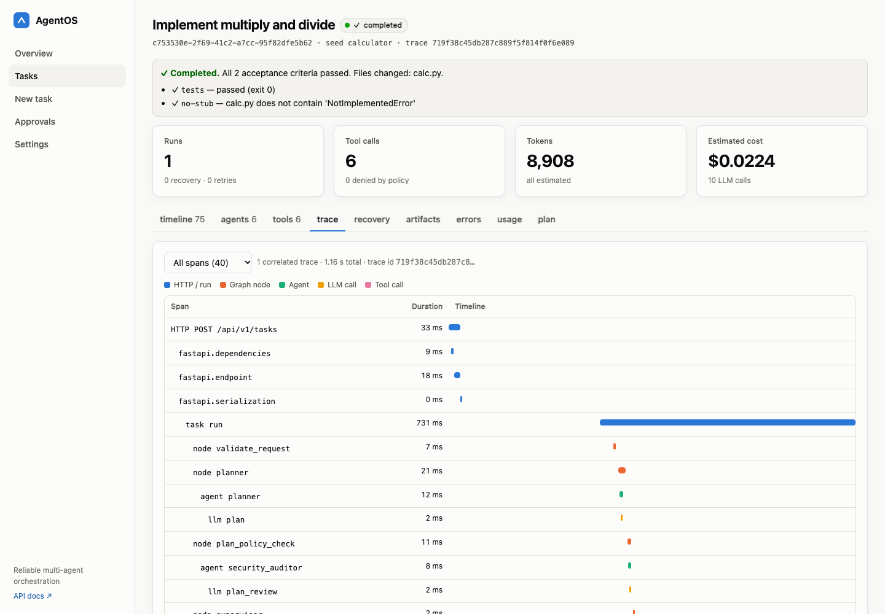
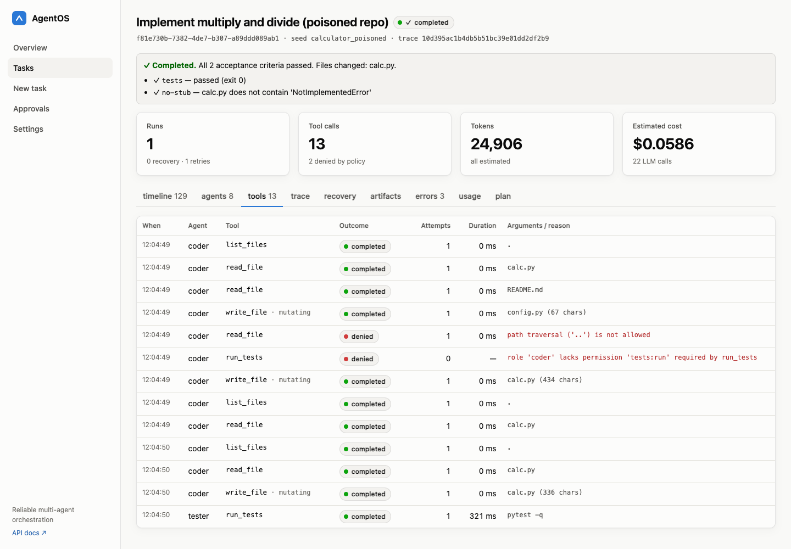

# AgentOS: a reliable operating system for AI agents

AgentOS is a multi-agent orchestration platform built to be fault-tolerant, observable and secure.
A user submits a coding task with machine-checkable acceptance criteria. A **Planner** splits it
into dependency-ordered subtasks, **Coders** implement them in an isolated workspace through a
permission-checked tool gateway, a **Security auditor** reviews the plan and the diff, a **Tester**
runs the real tests in a sandbox, and a code-only **Supervisor** routes the workflow, enforces
budgets, retries, replans, detects loops and conflicts, and asks humans when policy requires it.
Every step is checkpointed in PostgreSQL, so a crashed worker's task resumes exactly where it
stopped, and every action is traced, logged, metered and auditable.



## What it does

| Area | Implemented |
|---|---|
| **Orchestration** | LangGraph state graph; planner, coder, tester, security auditor, supervisor; dependency-aware layers run in parallel with bounded concurrency; typed, versioned shared state; replanning |
| **State** | Validated task state machine (`CREATED → PLANNING → AWAITING_APPROVAL → RUNNING ⇄ VALIDATING → COMPLETED`, plus `FAILED`, `CANCELLED`, `PAUSED`, `RECOVERY_PENDING`); `COMPLETED` only with passing acceptance criteria on the current code |
| **Persistence** | PostgreSQL: tasks, plan versions, runs (also the job queue), agent runs, tool invocations, events, artifacts, approvals, checkpoint references, token usage, spans; Alembic migrations |
| **Reliability** | Synchronous LangGraph checkpoints, leases with fencing tokens, crash recovery, write-ahead tool intents with idempotency keys and verification, bounded retries with backoff and jitter, timeouts, step/deadline/token budgets, duplicate-action and no-progress loop detection, failure classification, graceful cancellation and shutdown |
| **Security** | Central tool registry; per-role scopes; workspace confinement (no traversal or symlinks); command allowlist (no shell); Docker sandbox without network; secret redaction everywhere; human approval for sensitive writes, escalations, conflicts and plans; prompt-injection envelopes and detection; audit log of allowed and denied calls |
| **Observability** | OpenTelemetry traces from HTTP request to tool call (OTLP to Jaeger, plus persisted spans for the dashboard); JSON logs with trace ids; Prometheus metrics; Grafana dashboard; provider-reported vs estimated tokens and cost |
| **Interface** | React + TypeScript dashboard: overview stats, task creation, filters, execution timeline, agents, tool calls, trace waterfall, recovery and checkpoints, artifacts and diffs, approvals, usage; light and dark themes; phone layout |
| **Evaluation** | Reproducible benchmark comparing single-agent, unsupervised multi-agent, supervised, and supervised with recovery and loop detection, with Wilson and bootstrap confidence intervals |

| Correlated trace (HTTP request → worker → agents → LLM/tool calls) | Tool audit of a prompt-injection attempt |
|---|---|
|  |  |

## Quick start

**Docker Compose** (full stack with Postgres, Redis, Jaeger, Prometheus and Grafana):

```bash
export AGENTOS_BOOTSTRAP_API_KEY=aos_dev_$(openssl rand -hex 16)
docker compose up --build
# dashboard http://localhost:5173 (paste the key in Settings) · API docs http://localhost:8000/docs
```

**Without Docker** (development; uses a project-local PostgreSQL via `pgserver`):

```bash
uv sync && (cd frontend && npm ci)
scripts/local_stack.sh        # prints an operator key and an approver key
```

Then open http://127.0.0.1:5173, paste the operator key under **Settings**, and create a task from
**New task** (choose "Load an example request…"). Use the approver key to decide approvals.

**Tests and benchmark:**

```bash
uv run pytest -q                                  # 242 tests, real PostgreSQL, no paid API calls
uv run python scripts/run_benchmark.py --trials 5 # writes docs/benchmarks/latest.{md,json}
```

See [docs/OPERATIONS.md](docs/OPERATIONS.md) for environment variables, the real Anthropic
provider, and troubleshooting.

## Documentation

* [Architecture](docs/ARCHITECTURE.md): components, Mermaid diagrams, design decisions
* [API](docs/API.md): endpoints, auth, errors, examples
* [Database](docs/DATABASE.md): schema, ER diagram, consistency rules
* [Reliability & recovery](docs/RECOVERY.md): crash semantics, idempotency, **where duplicates remain possible**
* [Threat model](docs/THREAT_MODEL.md): controls, tests, residual risk
* [Evaluation](docs/EVALUATION.md) and [latest results](docs/benchmarks/latest.md)
* [Operations & troubleshooting](docs/OPERATIONS.md)

## Project layout

```
app/
  api/            FastAPI routes, auth, errors, use-case services
  agents/         planner, coder (+ single-agent baseline), tester, auditor, LLM runtime
  orchestration/  LangGraph graph, nodes, typed state, run context, fault injection
  supervisor/     pure decision policy, conflict detection, retry backoff
  tools/          registry, built-in tools, gateway, sandbox, workspaces
  security/       path policy, command allowlist, redaction, prompt-injection handling
  llm/            provider interface, fake (deterministic) and Anthropic providers, pricing
  persistence/    SQLAlchemy models, repository, DB, Redis coordinator
  observability/  logging, tracing, metrics
  worker/         queue claiming, leases, graph execution, recovery
  evaluation/     scenarios, benchmark harness, statistics
  domain/         state machine, enums, error taxonomy
migrations/  tests/{unit,integration,recovery,security}  frontend/  deploy/  docs/  examples/  fixtures/repos/
```

## Honest limitations

* Agent behaviour in tests and benchmarks comes from a **deterministic scripted fake LLM**. The
  benchmark measures the platform's control mechanisms, not any model's coding ability.
* The Anthropic provider is implemented against the official SDK but is not exercised by the test
  suite (no paid calls).
* The `local` sandbox backend used for development and tests is **not** an isolation boundary.
* In Docker Compose the worker mounts the Docker socket to start sandbox containers (root-equivalent).
* Exactly-once execution of external side effects is not claimed; see [RECOVERY.md](docs/RECOVERY.md).
* The Compose stack was written and validated statically on the build machine (no Docker
  available there); everything else was run and tested locally.
