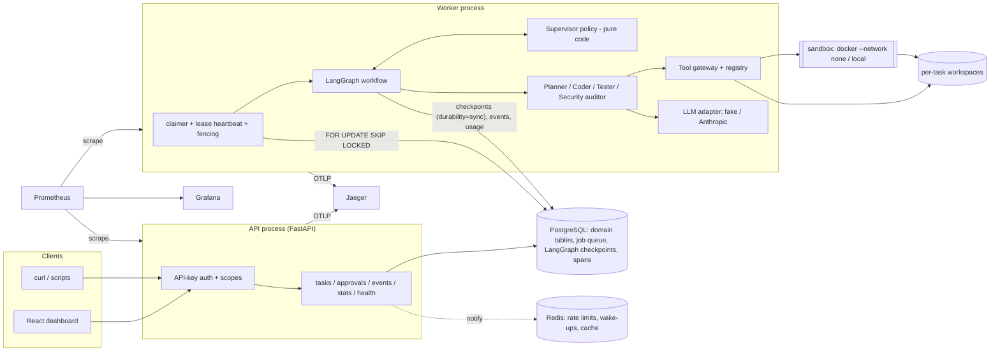
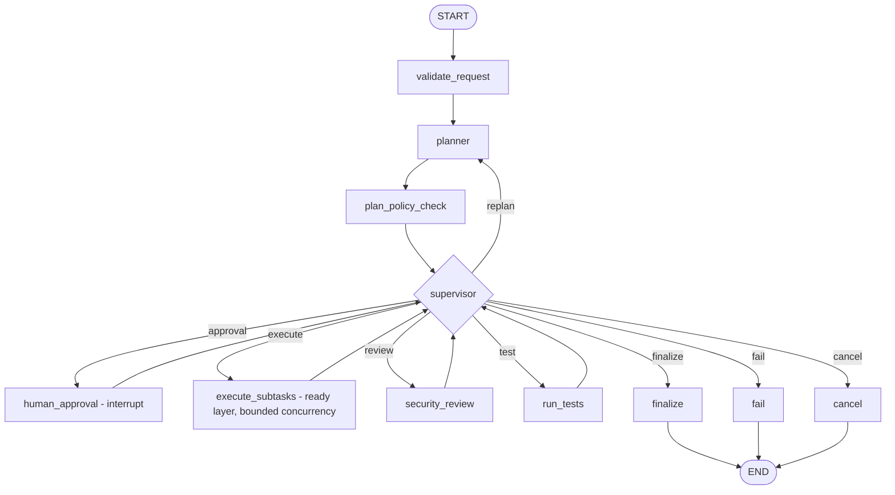

# Architecture

AgentOS is a **modular monolith** with two process types built from one codebase:

* **API** (`app/main.py`, FastAPI): authentication, validation, task/approval endpoints, stats. It
  never runs agents; it writes rows and enqueues runs.
* **Worker** (`app/worker/`): claims runs from a PostgreSQL queue, executes the LangGraph workflow,
  heartbeats its lease, and recovers runs whose worker died.

PostgreSQL is the single source of truth. Redis is optional and never on the correctness path.

## Workflow graph

The single-agent baseline graph is `validate_request -> single_agent -> run_tests -> finalize | fail`.

## Key decisions

| Decision | Why |
|---|---|
| Job queue is the `task_runs` table (claim with `FOR UPDATE SKIP LOCKED`, lease + fencing token) | Queue and task state cannot diverge; no extra broker to keep consistent. |
| LangGraph `AsyncPostgresSaver`, `durability="sync"` | A checkpoint is committed after every node *before* the next node starts, so resume is exact. |
| Live resources (DB, LLM, gateway, fencing token) in a `ContextVar`, not graph state | Checkpoints hold only data; whichever worker resumes rebuilds resources. |
| Supervisor is a pure function (`app/supervisor/policy.py`) | No model output can talk it out of a budget or policy; exhaustively unit-tested. |
| Every tool call goes through `ToolGateway` | One place for validation, authorization, path/command policy, approvals, duplicate detection, write-ahead intents, retries, output limits and audit. |
| Completion requires machine-checked acceptance criteria | `validate_transition(..., COMPLETED)` raises unless `criteria_passed=True`; `finalize` also checks the test evidence matches the current code fingerprint. |
| Agents get minimal context | A coder sees its subtask, the criteria and feedback, not other agents' transcripts. |
| Fake LLM is replay-deterministic | Responses depend on request identity, not call order, so crash recovery can be tested exactly. |

## Shared state (`app/orchestration/state.py`)

`WorkflowState` is a typed, versioned (`schema_version`) dict: plan + version, per-subtask status and
attempt, agent results, security review, test report, loop-detection history, pending approval,
counters (steps, tokens, retries, replans) and the error record. A resumed run refuses to continue
from a checkpoint with an unknown schema version (the task is parked in `RECOVERY_PENDING`).

## Task state machine (`app/domain/states.py`)

`CREATED -> PLANNING -> [AWAITING_APPROVAL] -> RUNNING <-> VALIDATING -> COMPLETED`, plus `FAILED`,
`CANCELLED`, `PAUSED`, `RECOVERY_PENDING`. Transitions are validated and recorded
(`state_transitions` + an event) in the same transaction as the status update.

## Agents

| Role | Responsibility | LLM output | Decides with code |
|---|---|---|---|
| Planner | request -> plan with subtasks, dependencies, risks | `Plan` (validated: unique ids, no cycles) | — |
| Coder | implement one subtask with tools | `AgentStep` per step | gateway enforces everything |
| Tester | run acceptance criteria, explain failures | `TestAnalysis` (explanations only) | pass/fail from exit codes and file checks |
| Security auditor | review plan and diff | `AuditorAssessment` | deterministic rules; the model can escalate, never downgrade |
| Supervisor | routing, budgets, retries, replans, loops, conflicts | none | entirely |

## Observability

* Traces: HTTP request -> `task run` -> `node *` -> `agent *` -> `llm *` / `tool *`, one trace per task
  (the task's `traceparent` is stored and reused by every run). Exported via OTLP and to the
  `spans` table for the dashboard.
* Logs: JSON (structlog) with `task_id`, `run_id`, `worker_id`, `trace_id`, `span_id`; a redaction
  processor runs on every record.
* Metrics: Prometheus counters/histograms (`app/observability/metrics.py`); `/api/v1/stats`
  computes the same rates from PostgreSQL across all processes.
