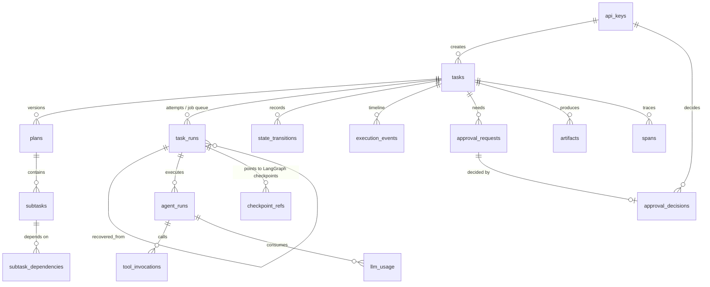

# Database

PostgreSQL 17 (any version supported by psycopg 3 works). Schema managed by Alembic
(`migrations/versions/0001_initial_schema.py`); LangGraph's checkpoint tables are created by
`AsyncPostgresSaver.setup()`. Both run with `python -m app.cli migrate`.

| Table | Purpose | Notable constraints / indexes |
|---|---|---|
| `api_keys` | hashed keys + scopes | unique `key_hash` |
| `tasks` | request, **authoritative status**, result/error, trace context | unique `idempotency_key`; `(status, created_at)`; optimistic `version` |
| `state_transitions` | every status change with actor and reason | `(task_id, created_at)` |
| `plans`, `subtasks`, `subtask_dependencies` | immutable plan versions | unique `(task_id, version)`, `(plan_id, key)` |
| `task_runs` | attempts **and** the job queue: lease, fencing token, resume payload | unique `(task_id, attempt)`; **partial unique index: one QUEUED/RUNNING run per task**; `(status, created_at)` |
| `agent_runs` | each agent invocation; `replay_count` after crash replays | unique `idempotency_key` |
| `tool_invocations` | audit + write-ahead intents (`INTENT/COMPLETED/FAILED/DENIED/ABANDONED/RECONCILED`) | unique `idempotency_key`; `(task_id, created_at)`; `status` |
| `execution_events` | append-only timeline with trace/span ids | unique `(task_id, seq)` and unique `idempotency_key` |
| `artifacts` | diff, test report, plan, summary, failure report (inline ≤ 64 KB, else file) | unique `idempotency_key` |
| `checkpoint_refs` | references to LangGraph checkpoints, `restored` flag | unique `(thread_id, checkpoint_id)` |
| `approval_requests`, `approval_decisions` | human-in-the-loop | one decision per request (unique `approval_id`) |
| `llm_usage` | tokens per call, `source` (`provider_reported`/`estimated`), estimated cost, pricing version | `task_id` |
| `spans` | finished OpenTelemetry spans for the dashboard | `trace_id`, `task_id` |

## Consistency strategy

* `tasks.status` changes only via `transition_task`, in the same transaction as its
  `state_transitions` row and event.
* Graph position lives only in LangGraph checkpoints; `checkpoint_refs` stores pointers, not copies.
* Subtask progress lives only in graph state (and is observable via `agent_runs`); plan rows are
  immutable. There is no second mutable copy of execution state.
* Append-only tables use idempotency keys so replayed nodes do not duplicate records. Event `seq`
  is allocated by incrementing `tasks.event_seq` (gaps are possible after a deduplicated insert).
